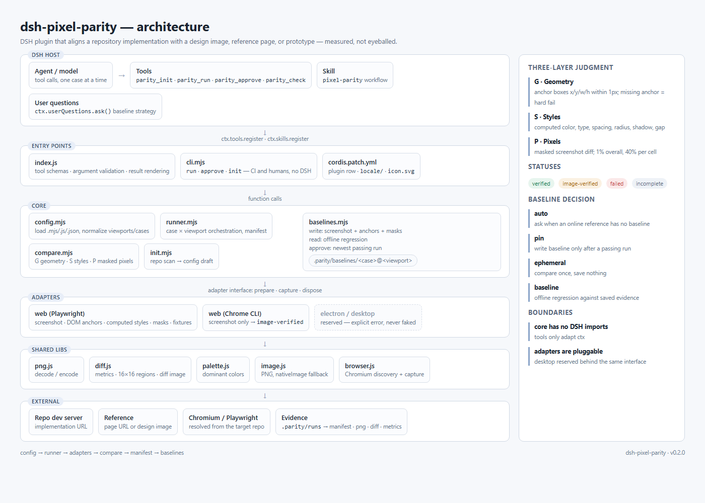
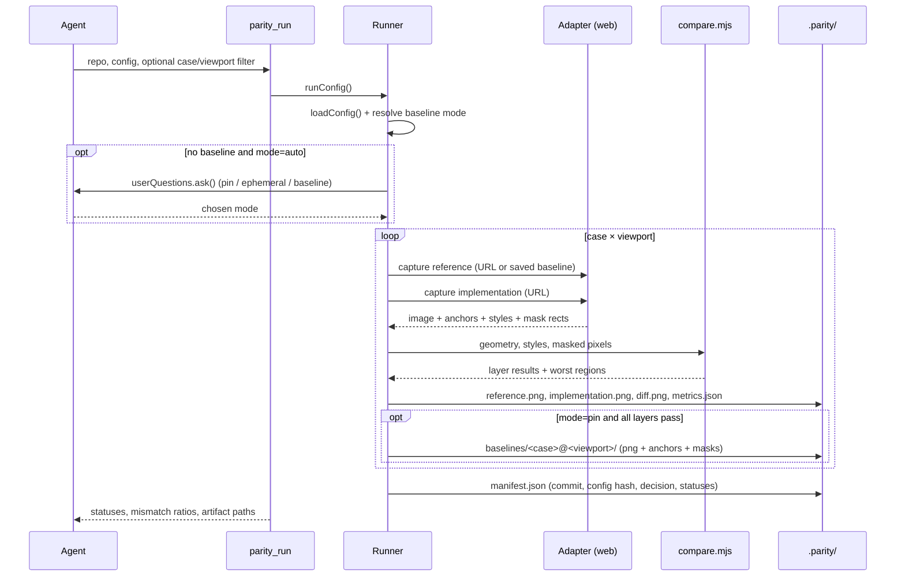

# Architecture



## Layers

| Layer | Files | Responsibility |
| --- | --- | --- |
| DSH host | — | Agent calls tools; `ctx.tools` / `ctx.skills` / `ctx.userQuestions` |
| Entry points | `index.js`, `cli.mjs` | tool schemas, argument validation, result rendering; standalone CLI for CI |
| Core | `core/config.mjs`, `core/runner.mjs`, `core/compare.mjs`, `core/baselines.mjs`, `core/init.mjs` | configuration, orchestration, G/S/P judgment, evidence and baselines, repo discovery |
| Adapters | `adapters/web.mjs` | capture one side: screenshot, DOM anchors, computed styles, masks, fixtures |
| Shared libs | `lib/png.js`, `lib/diff.js`, `lib/palette.js`, `lib/image.js`, `lib/browser.js`, `lib/check.js` | PNG codec, pixel comparison, dominant colors, image loading, Chromium discovery |
| External | — | implementation dev server, reference URL/image, Playwright or Chromium, `.parity/` |

`core/` does not import anything from `@deepseek-ai/*` and does not touch DSH services.
`index.js` is the only place that adapts host APIs.

## One run



## Judgment model

Each case × viewport produces three layer results and one status:

| Layer | Input | Rule |
| --- | --- | --- |
| **G geometry** | anchor `getBoundingClientRect` on both sides | every edge within 1px; a missing anchor is a hard failure |
| **S styles** | computed style whitelist | exact after normalization; lengths 0.5px tolerance; font family is a warning |
| **P pixels** | screenshots after masking | overall ≤ `maxMismatch` (1%), every 16×16 cell ≤ `maxRegionMismatch` (40%), blank-capture guard |

Status: `verified` (G/S/P), `image-verified` (P only, no anchors), `failed`, `incomplete`
(capture error). A tool can lower a status, never raise it.

## Evidence and baselines

```
.parity/
  runs/<runId>/
    manifest.json          # commit, config sha256, decision, statuses, summary
    cases/<case>/<viewport>/
      reference.png
      implementation.png
      diff.png
      metrics.json         # layer details, regions, anchors
  baselines/<case>@<viewport>/
    implementation.png
    baseline.json          # anchors + mask rects + approval metadata
```

`baseline` runs replace the reference with the saved evidence, so geometry and style
verification survive offline. `pin` writes a baseline only when the run passes; `approve`
promotes a passing run explicitly.

## Extension points

- **New surface** (`electron`, `desktop`): implement `prepare / capture / dispose`, add the
  id to `SURFACES`, and branch in `core/runner.mjs`. Until then those surfaces fail
  explicitly instead of degrading silently.
- **New reference kind** (for example Figma): extend `core/config.mjs` targets and add a
  capture path that produces an image plus optional anchors.
- **New output target**: the IR export (`core/ir.mjs` + `core/ir-web.mjs`) is the seam.
  A generator consumes `ir.json`; the web renderer is the reference implementation that
  proves the IR carries enough information. See `docs/IR.md`.
- **New judgment layer**: add a function to `core/compare.mjs`, include it in the status
  calculation; keep the manifest shape additive.

## Boundaries

- The runner never starts a dev server: it attaches to a running implementation URL.
  `start` is reserved.
- The Chrome CLI fallback cannot read the DOM, so its runs are `image-verified` and
  fixtures are rejected with an explicit error.
- Artifacts always land under the target repo's `.parity/`; the plugin does not write into
  the profile or anywhere else.
