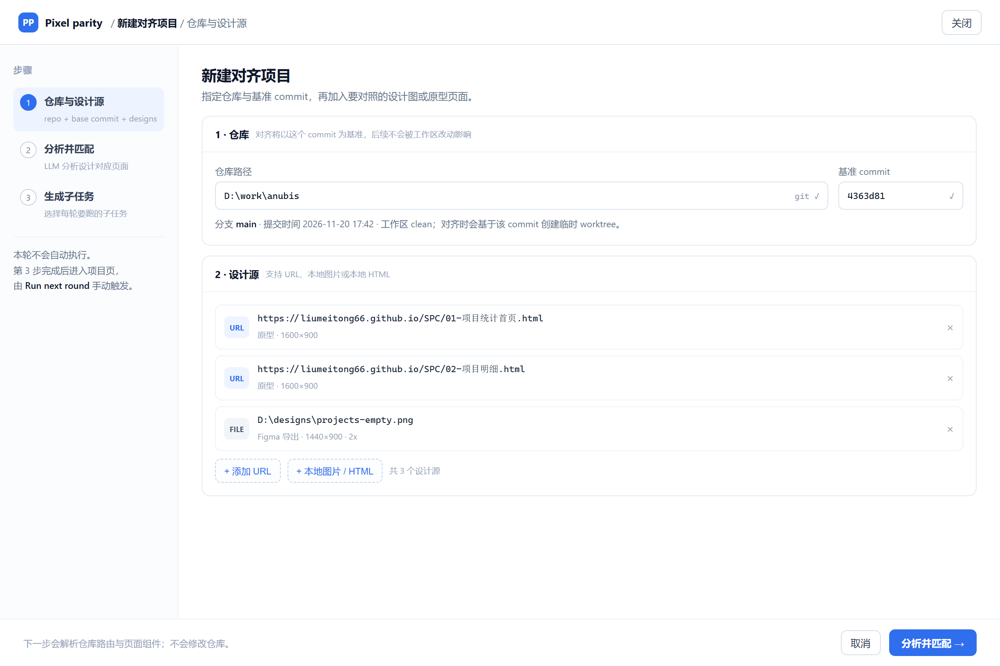
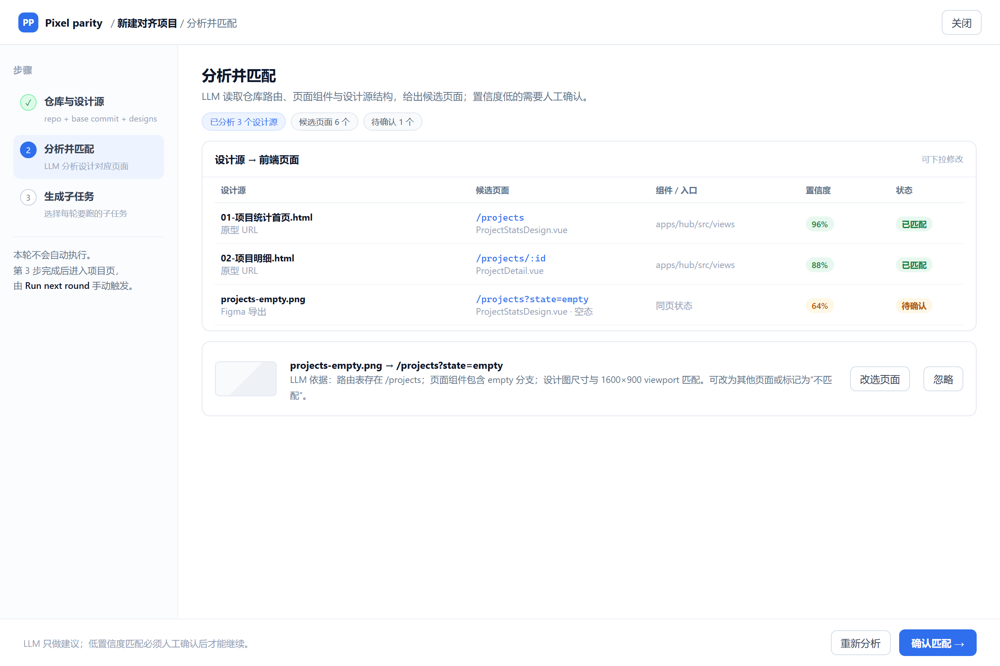
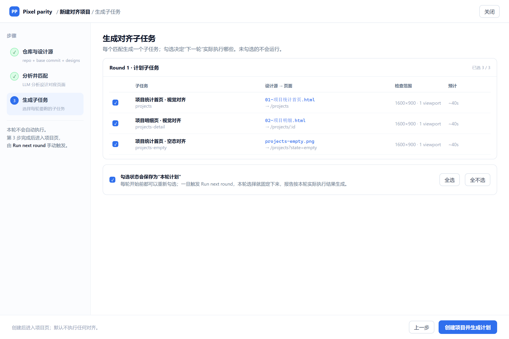
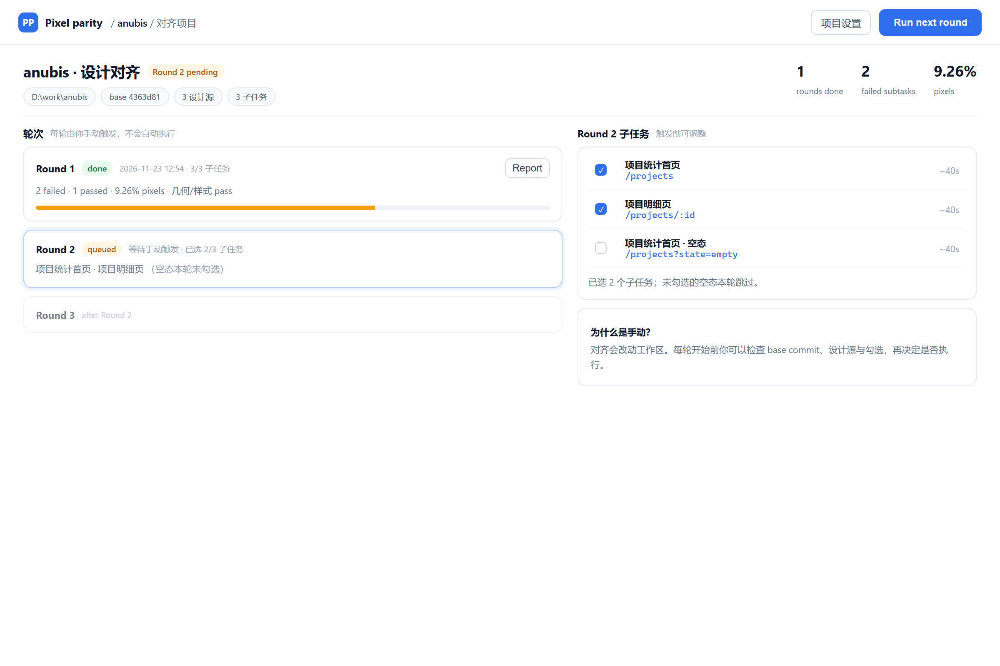
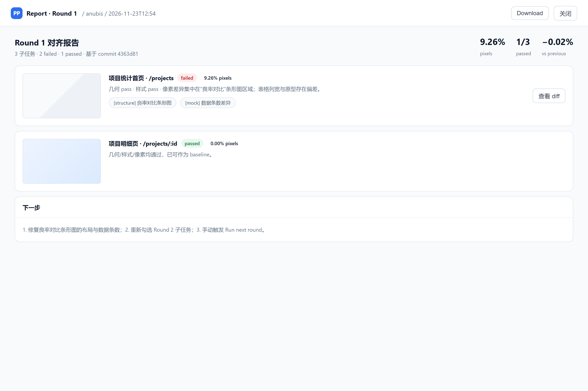

# PixelParity 项目式对齐流程（交互设计）

> 状态：设计稿，未实现  
> 目标读者：产品/前端/插件开发者  
> 预览图：`docs/design/assets/*.png`（由 `docs/design/render-mockups.mjs` 生成）

## 0. 一句话

把现在的“Task 列表”升级为 **项目（Project）→ 轮次（Round）→ 子任务（Subtask）** 三层：
一个项目绑定一个 repo 和一个 base commit，容纳多个设计源；LLM 把设计源匹配到前端页面并生成子任务；
每轮由用户**手动**触发，只执行本轮勾选的子任务；每轮结束生成可内嵌查看的报告。

## 1. 目标 / 非目标

### 目标

1. 一个项目可以同时管理多个设计图/原型，不需要为每个页面手工建 Task；
2. repo 有明确的 **base commit**，后续所有轮次都可追溯到同一基线；
3. 设计源 → 前端页面的映射由 LLM 给出候选，**人可确认/改选**；
4. 子任务是稳定实体，每轮通过勾选决定执行范围；
5. 对齐**不自动跑**：必须点 `Run next round` 才执行一轮；
6. 每轮结束生成报告，在 DSH 内置页面查看，也可下载；
7. 用户仓库不被直接改动：项目使用基于 base commit 的独立 worktree。

### 非目标

- 不做定时/后台自动对齐；
- 不做“一个 repo 一个大 Task”的混合状态；
- 不在本轮设计里做多人协作/权限；
- 不保证 LLM 首次匹配一定正确，必须保留人工改选。

## 2. 核心概念

| 概念 | 说明 |
| --- | --- |
| **Project** | 一个 repo + 一个 base commit + 一组设计源 + 匹配关系 + 子任务 + 轮次历史 |
| **DesignSource** | 设计图/原型，支持 URL、本地图片、本地 HTML；创建时缓存快照与尺寸 |
| **Match** | 设计源 → 前端页面（route + component）的对应关系，含置信度与人工确认状态 |
| **Subtask** | 由 Match 生成的稳定对齐单元（一个设计源对应一个页面/状态）；带默认勾选 |
| **Round** | 一次手动触发的执行；包含本轮勾选的 Subtask 快照、执行结果、报告 |
| **Report** | 每轮结束生成的 HTML；内嵌查看 + 下载；按轮次归档 |

> 迁移关系：现有 Task 相当于一个 Subtask 的一次执行记录；Project 负责分组与轮次编排。

## 3. 交互预览

### 3.1 第 1 步：仓库 + base commit + 设计源



界面说明：

- **仓库路径**：必须是 git 仓库；右侧显示 `git ✓`。校验失败时禁止下一步。
- **基准 commit**：默认 `HEAD`，可填 SHA/tag/branch；必须是仓库内可解析的 commit。
  - 显示分支、提交时间、工作区是否 clean；
  - 对齐时基于该 commit 创建独立 worktree，不直接改用户工作区。
- **设计源列表**：每行显示类型（URL/FILE）、位置、尺寸/倍率。
  - `+ 添加 URL`：支持 `http(s)` 原型页；
  - `+ 本地图片 / HTML`：支持 png/jpg/webp/html，路径必须在允许的本地根内；
  - 每行可删除；重复地址会提示去重。
- 底部 **分析并匹配**：进入第 2 步；此步不修改仓库。

交互细节：

- 添加 URL 时立即抓取一次，记录 `viewport`、标题、可访问性；抓取失败允许保留但标记 `unreachable`。
- 本地图片记录尺寸与 `@2x` 倍率，作为默认 viewport 依据。
- 所有设计源在项目目录下缓存快照（`sources/<id>.png`），避免原型后续变化影响历史轮次。

### 3.2 第 2 步：LLM 分析与页面匹配



界面说明：

- 顶部统计：已分析设计源数、候选页面数、待确认数。
- 表格每行：设计源 → 候选页面（route + 组件）→ 组件/入口目录 → 置信度 → 状态。
- 置信度分级：
  - `≥ 80%`：已匹配（可直接进入下一步）；
  - `50%–80%`：待确认（必须人工改选或标记忽略）；
  - `< 50%`：不匹配（默认不生成子任务）。
- 待确认行提供 **改选页面 / 忽略**；展开区显示 LLM 依据（路由、组件、空态分支、尺寸匹配）。
- **重新分析** 会重新跑匹配，但不会覆盖人工已确认的映射（除非用户选择“全部重算”）。

LLM 输入：

1. 仓库路由表、页面组件路径、组件树/关键文本、空态/错误态分支；
2. 设计源截图、DOM（原型 URL）、尺寸/viewport；
3. 现有匹配作为上下文（增量分析）。

LLM 输出（结构化）：

```json
{
  "match": {
    "sourceId": "src_01",
    "route": "/projects",
    "component": "apps/hub/src/views/ProjectStatsDesign.vue",
    "state": "default",
    "confidence": 0.96,
    "rationale": "路由存在 /projects；页面标题与原型一致；尺寸 1600x900 匹配"
  }
}
```

规则：

- LLM 只能从仓库真实存在的 route/component 中选择，插件做二次校验；
- 一个设计源可匹配多个页面（例如同一页面的 default/empty 状态），生成多个候选；
- 人工确认结果持久化，后续重分析不覆盖。

### 3.3 第 3 步：生成子任务与勾选计划



界面说明：

- 每个确认的 Match 生成一个 **Subtask**：名称、slug、设计源 → 页面、检查范围（viewport）、预计耗时。
- 每行前的 checkbox 决定 **本轮** 是否执行；默认全选。
- `已选 3 / 3` 实时更新；`全选 / 全不选` 快捷操作。
- **创建项目并生成计划**：写入 Project，进入项目页；此刻仍**不执行**任何对齐。

勾选语义：

- 勾选状态保存为“下一轮计划”（`nextSelection`）；
- 每轮触发时把当前勾选快照写入该轮 `selection`，之后修改勾选只影响下一轮；
- 报告会列出本轮未勾选（skipped）的子任务，避免误以为全部执行。

### 3.4 项目页：轮次 + 手动触发



界面说明：

- 顶部：项目名、`repo`、`base 4363d81`、设计源数、子任务数。
- 右上角 **Run next round**：唯一执行入口；没有定时器、没有自动排队。
- 轮次列表：`queued / running / completed / failed`；每轮显示时间、执行/跳过数、通过/失败、像素、报告入口。
- 右侧：下一轮子任务勾选（触发前可改）；未勾选显示为 skipped。
- 点击 `Run next round` 后：
  1. 冻结本轮选择；
  2. 设置 `Round.status = running`；
  3. 按选择顺序执行子任务；
  4. 完成后允许生成/查看报告。

执行模型（重要）：

- 一轮 = **Agent 修复（LLM）+ 插件测量** 的一次完整对齐 pass：
  - 有上一轮报告/plan 时，Agent 先按 plan 在项目 worktree 内修改代码；
  - 插件随后对每个子任务做一次测量并记录结果；
  - 首轮没有历史 plan 时退化为“只测量”（建立基线）。
- 按钮只发起一轮，**不会自动开始下一轮**；下一轮由用户再次点击。
- 若当前没有可用 Agent，Round 可停在 `awaiting-agent`，只完成测量并出报告（可配置）。

并发与安全：

- 同一项目同一时间只允许一个 running round；
- 所有写入发生在项目独立 worktree，用户仓库保持 clean；
- 关闭 DSH 会中断当前轮；Round 标记 `interrupted`，不会自动恢复执行。

### 3.5 每轮报告：内嵌查看



界面说明：

- 报告是 **按轮次** 生成的 HTML，标题包含 Round 编号、时间、base commit。
- 顶部汇总：像素均值、通过数/总数、相对上一轮变化。
- 每个子任务一张卡：设计缩略图、route、状态、像素、几何/样式结论、主要差异、`查看 diff`。
- 底部“下一步”：来自本轮的 findings，作为下一轮的修复计划。
- `Download` 下载 HTML；`关闭` 返回项目页。
- 报告只在 `Round.status = completed` 后可生成；running/失败中断时按钮禁用。

## 4. 数据模型与文件布局

```
data/projects/<projectId>/
  project.json          # repo, baseCommit, sources, matches, subtasks, rounds
  sources/              # 设计源缓存
  worktree/             # 基于 baseCommit 的 git worktree（对齐写入这里）
  rounds/
    round-1/
      round.json
      report.html
      assets/
    round-2/...
```

`project.json` 摘要：

```json
{
  "version": 1,
  "id": "proj-20261123-01",
  "name": "anubis · 设计对齐",
  "repo": "D:\\work\\anubis",
  "baseCommit": "4363d81",
  "status": "ready",
  "sources": [
    { "id": "src_01", "kind": "url", "location": "https://.../01-项目统计首页.html", "viewport": { "width": 1600, "height": 900 } },
    { "id": "src_02", "kind": "file", "location": "D:\\designs\\projects-empty.png", "viewport": { "width": 1440, "height": 900 }, "scale": 2 }
  ],
  "matches": [
    { "sourceId": "src_01", "route": "/projects", "component": "apps/hub/src/views/ProjectStatsDesign.vue", "state": "default", "confidence": 0.96, "status": "confirmed" }
  ],
  "subtasks": [
    { "id": "projects", "sourceId": "src_01", "title": "项目统计首页 · 视觉对齐", "route": "/projects", "state": "default", "defaultSelected": true }
  ],
  "nextSelection": ["projects", "projects-detail"],
  "rounds": [
    {
      "id": "round-1",
      "number": 1,
      "status": "completed",
      "selection": ["projects", "projects-detail", "projects-empty"],
      "skipped": [],
      "startedAt": "2026-11-23T12:54:00Z",
      "finishedAt": "2026-11-23T12:58:00Z",
      "reportPath": "rounds/round-1/report.html"
    }
  ]
}
```

状态：

```
Project: draft → analyzing → ready → running → ready
Round:   queued → running → completed | failed | interrupted
Report:  pending → generated
```

## 5. 工具与接口

### 工具（给 Agent）

```ts
parity_project({ action: "create", repo, baseCommit, name })
parity_project({ action: "add-source", projectId, kind: "url"|"file", location })
parity_project({ action: "analyze", projectId })            // 返回候选匹配
parity_project({ action: "confirm", projectId, matches })   // 人工确认/改选
parity_project({ action: "plan", projectId })               // 生成子任务与 nextSelection
parity_project({ action: "status", projectId })
parity_project({ action: "run-round", projectId })          // 手动触发一轮
parity_project({ action: "report", projectId, round })
parity_project({ action: "delete", projectId })             // 停止当前轮、删除 worktree 与数据
```

### Host 接口（给面板）

| 方法 | 路径 | 说明 |
| --- | --- | --- |
| GET | `/pixel-parity/projects` | 项目列表与摘要 |
| POST | `/pixel-parity/project/create` | 创建项目 |
| POST | `/pixel-parity/project/source` | 添加设计源 |
| POST | `/pixel-parity/project/analyze` | 触发分析 |
| POST | `/pixel-parity/project/confirm` | 保存匹配 |
| POST | `/pixel-parity/project/plan` | 生成子任务 |
| POST | `/pixel-parity/project/round` | 手动发起一轮 |
| GET | `/pixel-parity/project/round/job` | 轮次执行状态 |
| GET | `/pixel-parity/project/report?round=` | 内嵌报告 HTML |

## 6. 关键交互细节

1. **base commit 锁定**：项目创建后 baseCommit 不可改；要换基线必须新建项目（避免历史报告失真）。
2. **worktree 隔离**：所有轮次写入项目 worktree；报告记录 `git diff --stat baseCommit`，用户仓库保持原状。
3. **设计源快照**：创建/重新抓取时保存图片与 metadata；报告使用快照，不重新访问 URL。
4. **匹配置信度**：低置信度必须人工操作；不允许“自动忽略所有低置信度”后直接运行。
5. **勾选快照**：点击 Run next round 的瞬间冻结选择；执行中不可改本轮选择，只能改下一轮。
6. **手动唯一入口**：取消自动轮询/自动续跑；`Run next round` 是唯一触发点。
7. **报告时序**：轮次完成后才允许生成报告；running 时按钮禁用并给出 hover 原因。
8. **删除项目**：二次确认；若有 running round，先取消再删除 worktree 与项目目录。
9. **失败处理**：单个子任务失败不阻塞其他子任务；轮次结束标记 `failed` 仍可生成报告。
10. **演示数据**：报告/预览中的 9.26% 等数字来自当前 anubis 原型，仅作示意。

## 7. 与当前实现的关系

- 当前 `Task`（一次测量）可保留为内部执行单元：一个 Round 下每个选中的 Subtask 生成/关联一个 Task 执行记录；
- 当前“Repo 分组 + Run all”是过渡形态，后续由 Project 页替代：
  - Project 固定 repo/base commit；
  - Round 取代“Run all”；
  - 报告从“每 Task 一份”升级为“每轮一份聚合报告”，子任务结果内嵌。
- 已有 `data/tasks` 可保留用于独立快速检查；项目式流程是上层编排，不强制迁移旧任务。

## 8. 验收标准

- [ ] 可以创建项目：repo 校验、base commit 校验、添加 URL/本地设计源；
- [ ] 分析后得到候选页面表，低置信度需人工确认，确认结果持久化；
- [ ] 生成子任务列表，勾选状态可保存并影响下一轮；
- [ ] 项目页展示历史轮次；未点 `Run next round` 不会执行任何对齐；
- [ ] 每点一次只执行一轮，且本轮只跑勾选的子任务，报告记录 skipped；
- [ ] 轮次完成后可生成报告并在 DSH 内嵌页查看/下载；
- [ ] 删除项目会停止运行中的轮次并清理 worktree/报告；
- [ ] 用户仓库在工作区保持 clean，所有改动落在项目 worktree。

## 9. 风险与开放问题

| 风险 | 处理 |
| --- | --- |
| LLM 页面匹配错误 | 置信度阈值 + 人工确认 + 可改选 |
| 原型是动态数据/需登录 | 设计源抓取支持 storageState；报告记录抓取条件 |
| 本地路径越权 | 限定允许根目录，拒绝任意系统路径 |
| worktree 磁盘占用 | 项目删除时清理；可配置保留轮次数 |
| 一轮内“LLM 修复”依赖 Agent 可用性 | 无 Agent 时退化为测量+报告，状态标注 |
| base commit 后仓库有未提交改动 | 项目只用 worktree，忽略用户工作区脏状态 |

**待定**：是否需要“Round 0 基线测量”单独展示；报告是保留所有轮次还是只保留最近 N 轮；项目 worktree 是否允许用户手动打开编辑。
